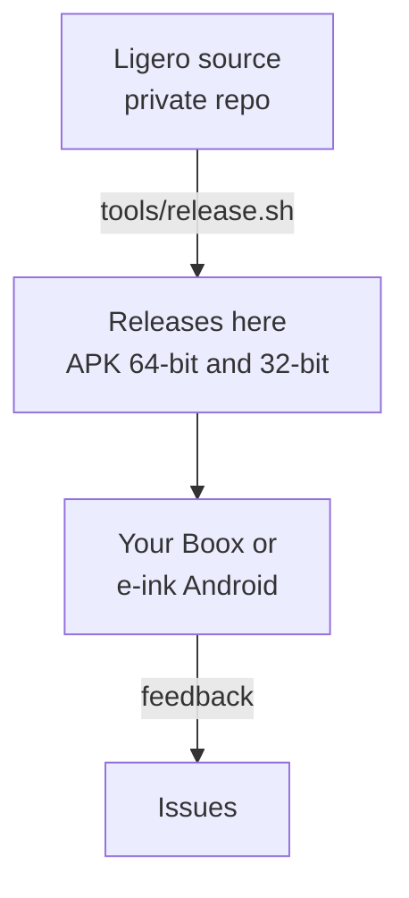

# Ligero

A fast, lightweight PDF reader for e-ink Android devices, built for the **Boox Go Color 7 (Gen II)**. This repository only hosts test builds; the source code is not public.

## At a glance



## What it does

- **Plans, maps and drawings:** pinch to zoom, drag to pan and double-tap the center, like any PDF reader. When you let go, only the visible area is redrawn sharp.
- **Scanned books:** splits double-page spreads, trims margins and straightens pages.
- **Reflow mode:** lays out a scanned page again with larger text, without OCR and without text errors.
- **Convert to EPUB** with on-device text recognition.
- **Automatic e-ink refresh on Boox:** fast while moving and flipping through pages, clean when you let go.

Compared with NeoReader, the reader that comes with the Boox, using the same AutoCAD plans on the same device, Ligero opens the PDF about 3× faster, turns pages about 2.7× faster and uses 3–5× less memory.

## Install

1. On the device, open the [latest release](../../releases/latest) and download the APK for your device:
   - `Ligero-x.y.apk`: 64-bit Android on ARM, which is every recent Boox. If in doubt, start with this one.
   - `Ligero-x.y-32bit.apk`: devices that run a **32-bit Android**, even on a 64-bit processor, such as the Meebook Q78. On those the 64-bit APK does not install ("App not installed" or "not compatible").
2. Open it. If Android asks, allow installing apps from that source.

Requirements: Android 10 or later on an ARM processor. It is tested on the Go Color 7 Gen II; how it does on other devices is exactly what we want to find out.

Not sure which Android you have? An app like *CPU-Z* or *Device Info HW* shows it: if the supported ABIs (or "instruction sets") include `arm64-v8a`, use `Ligero-x.y.apk`; if they list only `armeabi-v7a`, use the 32-bit one.

### Get updates automatically

Install [Obtainium](https://github.com/ImranR98/Obtainium), tap **Add app** and paste:

```
https://github.com/F-N-LL/ligero-releases
```

It will tell you about each new version and install it over the old one, keeping your books and reading positions.

On a 32-bit device, before saving the app in Obtainium, set **Filter APKs by regular expression** to `32bit` so it always picks the right file. On 64-bit devices, if Obtainium asks which APK to install, choose the one without `32bit`.

## Feedback

[Open an issue](../../issues/new/choose): there is a template for bugs and one for ideas. The most useful details are **your device model and the kind of PDF** (scanned, digital, plan...). If the problem happens with a specific file you can share, even better.

The app's interface is in English and Spanish.
